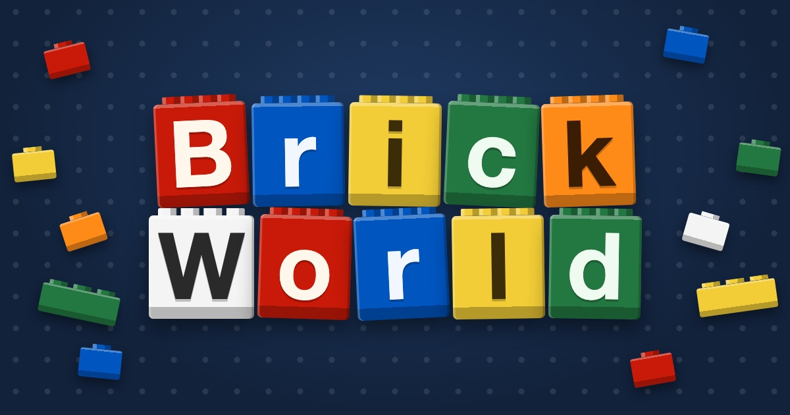
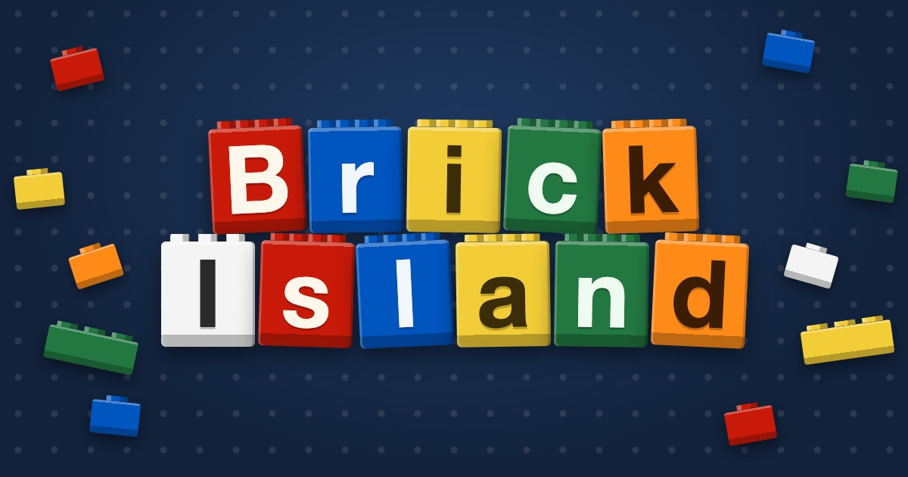

# Brick Workshop

**Build with real LDraw parts, in the browser.** One engine that knows what holds together
and what falls over, a workshop to design with it, and two games where a minifigure walks
through a world made of the same bricks.

<p align="center">
  <a href="#brick-studio"><b>Brick Studio</b></a> ·
  <a href="#brick-world"><b>Brick World</b></a> ·
  <a href="#brick-island"><b>Brick Island</b></a> ·
  <a href="#getting-started">Getting started</a> ·
  <a href="#how-its-organised">How it's organised</a>
</p>

---

## Brick Studio

<p align="center">
  <a href="https://brick-studio.larsvanbraam.nl"></a>
</p>

**The workshop.** Place pieces one by one and the engine checks every connection, collision
and support. Print a finished build as a step-by-step manual, or let Claude draft a starting point
for you to place on the canvas and finish by hand.

- Validates every placement and checks whether the build would stand, tip or need clutch.
- Imports LDraw and assembly files, and turns 3D models (`.skp`, `.dae`, `.glb`) into bricks.
- Prints building instructions as a PDF manual.
- Generates a draft with Claude from a description or reference photos; apply it to the canvas and take over by hand.

[**Open Brick Studio**](https://brick-studio.larsvanbraam.nl) · run it locally with `pnpm dev:studio` ·
[workshop details](apps/brick-studio/README.md)

---

## Brick World

<p align="center">
  <a href="https://brick-world.larsvanbraam.nl"></a>
</p>

**An endless world to wander and build in.** The land is generated from a seed and goes on
in every direction. Pick bricks from the box, put them down and take them off again; every
world keeps its own building.

[**Play Brick World**](https://brick-world.larsvanbraam.nl) · run it locally with `pnpm dev:world`

---

## Brick Island

<p align="center">
  <a href="https://brick-island.larsvanbraam.nl"></a>
</p>

**One hand-drawn island, made for exploring.** A harbour town, a farm, a lake and a mountain,
always in bright morning light. Walk round with the minimap, talk to the townsfolk and drive
the vehicles parked about the island. There's no building here, just somewhere to roam.

[**Play Brick Island**](https://brick-island.larsvanbraam.nl) · run it locally with `pnpm dev:island`

The two games share one codebase and differ only in their `GameConfig`: see [brick-game](packages/brick-game/README.md#two-games-one-codebase).

---

## Getting started

Requires Node.js 22.18+, 24.11+ or 26+ and pnpm 12.16.1.

```sh
pnpm install
pnpm ldraw:fetch   # optional: download the LDraw library into data/ldraw
pnpm dev:studio    # or pnpm dev:world, pnpm dev:island
```

Each dev server starts on http://localhost:5173, or the next free port. Without the LDraw
library the apps fall back to simplified procedural geometry; see
[data/README.md](data/README.md) to use a library elsewhere.

```sh
pnpm test    # Vitest via Vite Plus
pnpm check   # format, lint and typecheck
pnpm build   # typecheck, all apps, engine and adapter packages
pnpm fmt     # format the workspace
```

`pnpm build:studio` builds one app only; there are also `build:world`, `build:island` and
`build:packages`.

## How it's organised

Everything builds on `brick-engine`; the three apps sit on top.

| Package                                     | What it does                                                                                                          |
| ------------------------------------------- | --------------------------------------------------------------------------------------------------------------------- |
| [`brick-engine`](packages/brick-engine)     | Part catalogue, placement, collision and support checks, physics, export, instructions and the example builds. No UI. |
| [`claude-adapter`](packages/claude-adapter) | Lets Claude build through the engine's tools; the generation CLI and workshop server.                                 |
| [`brick-render`](packages/brick-render)     | LDraw loading, batched drawing, the cinematic look and the loading card.                                              |
| [`brick-game`](packages/brick-game)         | The game itself: world generation, building, menus, saves, minimap and quests.                                        |
| [`brick-walk`](packages/brick-walk)         | The minifigure controller: walking, gamepad and footsteps.                                                            |
| [`brick-npc`](packages/brick-npc)           | Wandering townsfolk and animals, and their talk.                                                                      |
| [`brick-vehicles`](packages/brick-vehicles) | Drivable vehicles, their models and sounds.                                                                           |
| [`brick-audio`](packages/brick-audio)       | The music composer and voices.                                                                                        |

`apps/brick-world` and `apps/brick-island` are thin shells around `brick-game`. `data` holds the
local, Git-ignored LDraw library and inventory downloads.

## Go deeper

- [The engine](packages/brick-engine/README.md): coordinates, parts, connections, physics, colours and the example builds.
- [The workshop](apps/brick-studio/README.md) and [the Claude adapter](packages/claude-adapter/README.md): saving, importing, generating with Claude.
- [The build standard](docs/build-standard.md): what a good build looks like.
- [Benchmarks against real sets](docs/rebrickable-benchmarks.md): how the examples compare with LEGO's own.

## Deploying

`apps/brick-studio/vercel.json` deploys the workshop as a static site: the build fetches the LDraw
library, packages only the supported parts with their attribution and licences,
and sets `VITE_WORKSHOP_GENERATION=false` to hide generation. Saving to
`builds/` and previews of arbitrary library parts need the local server.

The games deploy as their own Vercel projects from the same repository. Set a project's
**Root Directory** to `apps/brick-world` or `apps/brick-island` (leave "Include files
outside the root directory" on) and that app's `vercel.json` does the rest. It fetches the
same LDraw library, builds the game as a static site into the app's `dist` and needs no
environment variables.

The LDraw library is community-maintained, not LEGO-authored; keep its
attribution and licences when redistributing meshes or the palette.
