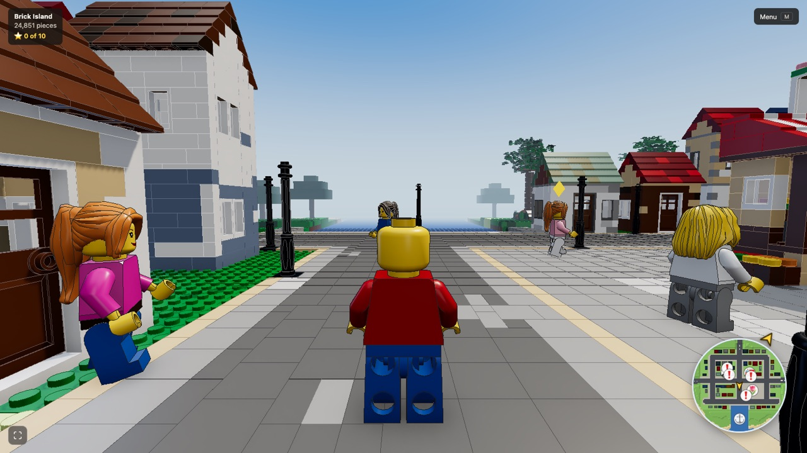
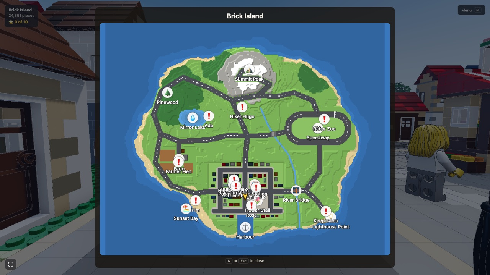

# Brick Island

One hand-drawn island to explore: a harbour town, a farm, a lake and a mountain. Live at
https://brick-island.larsvanbraam.nl.

<p align="center">
  <br>
  <sub>The harbour town: shops, lamp posts and townsfolk to talk to, with the minimap in the corner.</sub>
</p>

## The island

Press <kbd>N</kbd> to open the full map. Townsfolk with something to ask are marked with a
red <b>!</b>, and the landmarks include the harbour, a farm, Mirror Lake, Summit Peak, a
speedway and Lighthouse Point.

<p align="center">
  <br>
  <sub>The whole island on the map.</sub>
</p>

## About this app

This app is a thin shell: it calls `startGame(BRICK_ISLAND)` from
[`brick-game`](../../packages/brick-game), which holds the game and its configuration.

```sh
pnpm dev:island    # http://localhost:5173, or the next free port
pnpm build:island
```

Deployed as its own Vercel project; see Deploying in the [main README](../../README.md#deploying).
