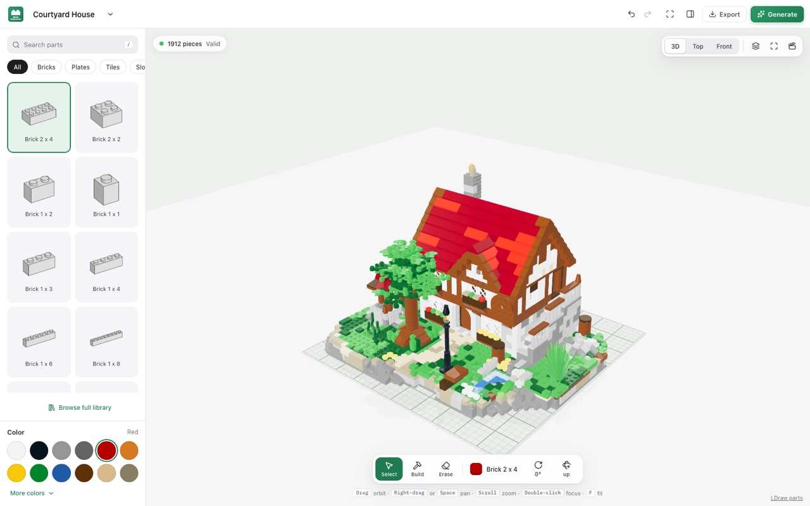

# Brick Studio

The workshop: a 3D viewer and editor where every placement is checked by
[`brick-engine`](../../packages/brick-engine). Live at https://brick-studio.larsvanbraam.nl.

<p align="center">
  <br>
  <sub>The Courtyard House example in the editor: 1,912 pieces, every connection valid.</sub>
</p>

```sh
pnpm dev:studio    # http://localhost:5173
pnpm build:studio
```

Also here: the building instructions tool (`instructions.html`) and `tooling/`, the scripts
that fetch the LDraw library, import colours and masses, and generate the Rebrickable
benchmark report. Generation with Claude is built on
[`claude-adapter`](../../packages/claude-adapter).

## Using the workshop

- **Saving.** The current build autosaves in the browser. **File → Save** (⌘S)
  writes `builds/<name>.json` (override with `WORKSHOP_BUILDS_PATH`); saved builds
  are listed under **File**. Only the dev and preview servers serve this folder.
- **Import** reads assembly JSON and workshop/CLI exports (up to 2 MB, 50,000
  pieces). Everything is revalidated against the current policy.
- **Building instructions** (**Export → Building instructions…**) turns a build
  into a printable PDF manual, ordering pieces so each comes after what it rests on.
- **Add 3D model** converts SketchUp (`.skp`), COLLADA (`.dae`) or `.glb` models in
  the browser: the surface is sampled into brick-sized cells, filled with wall
  bricks, roofs get slopes and detected openings get door and window frames.
- **Smooth surfaces** (**File**) dresses the whole build as one undoable edit:
  outside corners of plain 1 x 1 and 2 x 2 pieces turn round, cheese and curved
  slopes lean on steps, plate steps and open edges get tiles and corners
  quarter-round tiles; **…and add flowers** also scatters flowers on green tops.
  `smoothAssembly` in the engine does the work. Generate runs it on every draft
  for the pieces that run added (without flowers), and Claude can call it as
  `brick_smooth` mid-build or for flowers.
- **Generate** has Claude draft a build, optionally from up to four reference photos, in a
  separate dialog, either from scratch (**New**) or starting from the build on the canvas
  (**Current**). Claude can revise the draft there; nothing changes on the canvas until
  **Apply draft**, and after that the build is yours to edit by hand.

Generation needs the workshop server next to the dev server:

```sh
pnpm workshop:server
pnpm dev:studio
```

Set `ANTHROPIC_API_KEY` in the server's environment or the ignored root `.env`
(never in `VITE_` variables); `CLAUDE_MODEL` picks the model. Without a key the
server runs through your local Claude Code login instead, which is for personal
local use only. The server binds to `127.0.0.1:8787` (`WORKSHOP_API_PORT`) and
Vite proxies `/api/workshop` to it.
