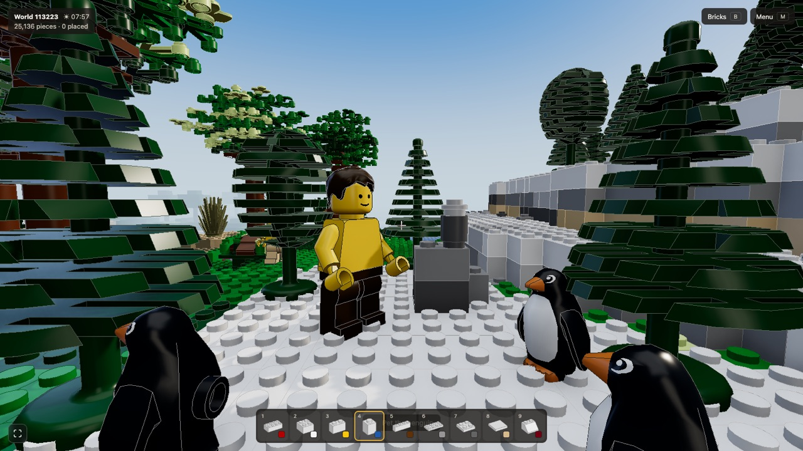
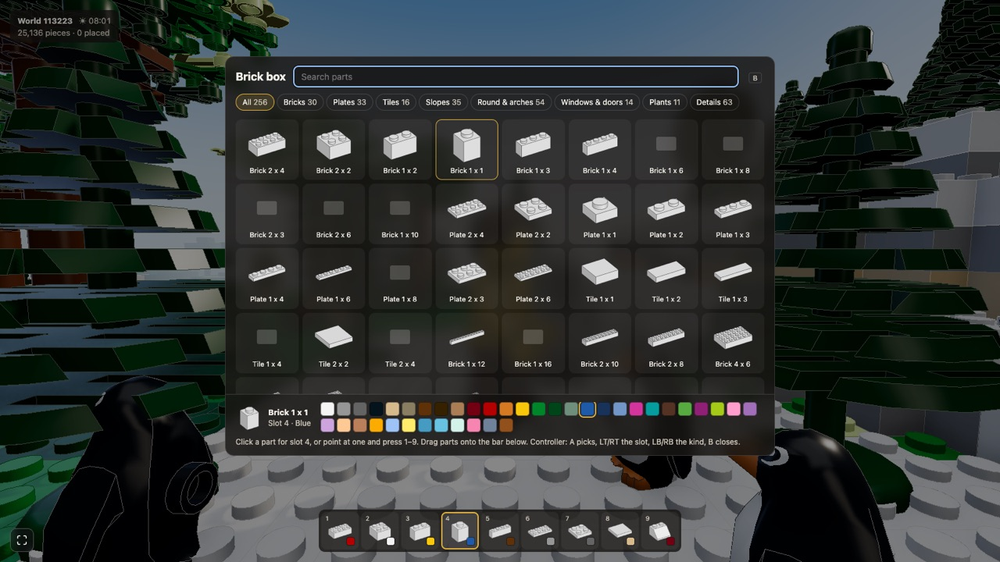

# Brick World

An endless generated world to wander and build in. Live at https://brick-world.larsvanbraam.nl.

<p align="center">
  <br>
  <sub>The land is made of real parts: pine forests, snowfields, desert, sea, and animals to meet.</sub>
</p>

## Building

Press <kbd>B</kbd> to open the brick box, pick parts and colours for the nine hotbar slots,
then place and take off pieces as you walk. Every world keeps its own building.

<p align="center">
  <br>
  <sub>The brick box: 256 parts in categories, with the colours below.</sub>
</p>

## About this app

This app is a thin shell: it calls `startGame(BRICK_WORLD)` from
[`brick-game`](../../packages/brick-game), which holds the game and its configuration.

```sh
pnpm dev:world    # http://localhost:5173, or the next free port
pnpm build:world
```

Deployed as its own Vercel project; see Deploying in the [main README](../../README.md#deploying).
